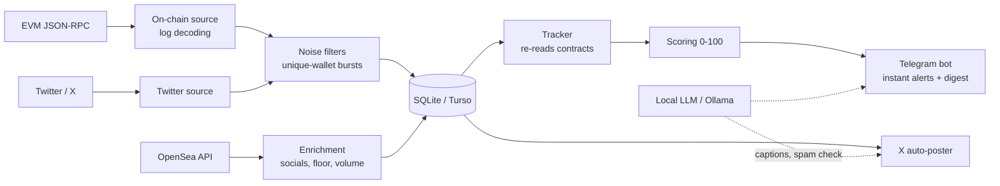

# NFT Mint Radar

**Real-time on-chain monitor that finds new NFT collections and live mints on an EVM chain, scores them, and alerts you in Telegram, usually before the project shows up on Twitter.**


> Built for a Web3 trader who wanted to catch whitelist (WL) and public mints on Robinhood Chain early, without watching block explorers and Twitter all day.

---

## The problem

New NFT drops go live on-chain hours before anyone posts about them, and most "mints" are noise: dev tests, Uniswap LP positions, domains, or one bot buying 40 tokens. Watching that by hand isn't realistic.

## What it does

- **Reads the blockchain directly** over JSON-RPC: decodes `Transfer` logs, finds new ERC-721/1155 contracts, and tracks mint progress, price and supply without any paid API.
- **Filters noise**: an alert fires only when **10+ unique wallets** mint within 2 hours. Bursts are counted by wallet, not by token, and utility NFTs (LP positions, domains, staking badges) are dropped.
- **Watches Twitter/X** for WL announcements hours before the mint.
- **Sends tiered Telegram alerts**: urgent events (🔥 mint surge, ⏳ almost sold out) go out instantly. Everything else is grouped into a digest every 2 hours, so there's no notification spam.
- **Live cards**: an alert message is **edited in place** every 5 minutes with mint progress, floor, holders and volume (via OpenSea), instead of new messages.
- **Scoring 0–100** for "how interesting is this project", with transparent rules (`tracking/scoring.py`) and `/top` and `/find` commands.
- **Reminders**: "⏰ remind me" buttons with notes that survive restarts.
- **Auto-posting to X** with captions rewritten by a **local LLM (Ollama)**. Guardrails reject any text with links or numbers that weren't in the source fact.
- **USD pricing**: mint price plus estimated gas, using CoinGecko and live gas price.
- **Pluggable storage**: local SQLite or **Turso (libSQL)** to share history across machines.

## Architecture



## Tech stack

`Python 3.11` · `asyncio` · `httpx` · `aiogram 3` · `aiosqlite` · `libSQL / Turso` · `pydantic` · `eth-utils` · `twscrape` · `Ollama` · `typer` + `rich` (CLI) · `Docker` · `pytest` (686 tests)

## Engineering highlights

- Fully async pipeline with independent sources, deduplication and back-pressure-safe polling.
- Every external dependency (OpenSea, LLM, Twitter, CoinGecko) is **optional and fails soft**. The bot keeps working without it.
- Interactive setup wizard that **validates the RPC endpoint** (reachability, current block, `eth_getLogs` support) before saving.
- One-click deployment for Windows (`start.bat`), macOS (Docker plus launchd auto-update from GitHub) and any VPS (`docker compose up -d`).
- Owner-only "🔄 Update from GitHub" button in the bot triggers a redeploy without SSH.

## Quick start

```bash
pip install -e .
python -m wlparser setup   # asks for RPC URL + Telegram bot token
python -m wlparser run
```

Or with Docker:

```bash
docker compose run --rm bot setup
docker compose up -d
```

Run the tests:

```bash
pip install -e ".[dev]" && pytest
```

---

📄 Detailed user documentation (Russian): [README.ru.md](README.ru.md)

💼 Need a blockchain monitor, trading alert bot or data pipeline like this? **[Hire me on Upwork](https://www.upwork.com/freelancers/~01b79ffa28442df3f8)**
